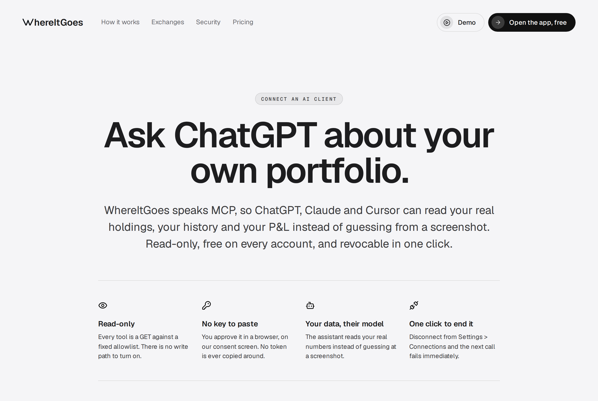
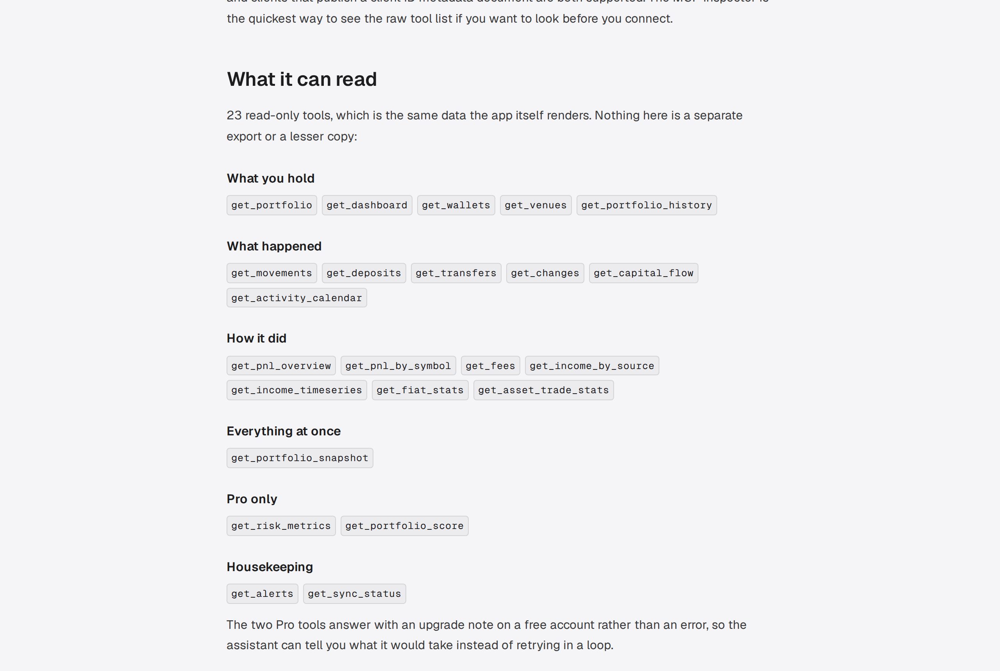

# WhereItGoes MCP server

Ask ChatGPT, Claude or Cursor about **your own crypto portfolio**: real holdings across every
exchange and on-chain wallet you track, full movement history, FIFO profit and loss, fees,
income and risk. No API key to paste, free on every account, revocable in one click.

```
https://api.whereitgoes.money/api/mcp
```

- **Transport**: Streamable HTTP (stateless, JSON responses)
- **Auth**: OAuth 2.1, authorization code + PKCE (S256). Dynamic client registration (RFC 7591) and Client ID Metadata Documents are both supported.
- **Registry name**: `money.whereitgoes/portfolio` in the [official MCP Registry](https://registry.modelcontextprotocol.io)
- **Setup guide**: [whereitgoes.money/connect-ai](https://whereitgoes.money/connect-ai)

This repository is the public listing and documentation for a hosted (remote) MCP server.
There is nothing to install or run locally.



## What it does

[WhereItGoes](https://whereitgoes.money) is a read-only crypto portfolio tracker. You connect
exchanges with read-only API keys and wallets by public address; it rebuilds your trade and
transfer history and computes portfolio value, P&L and history. The MCP server exposes those
same computed numbers to an AI client, so the assistant reads your real data instead of
guessing from a screenshot.

Every figure is already computed and USD-valued by the app. The server instructions tell the
model to report what the tools return rather than recompute it.

## Tools

15 tools: 13 reads and two propose-only writes. Each read is a GET against a fixed allowlist
of the app's own endpoints. Tools that cover several related answers take a required `view`
argument, and the answer comes back nested under the key named after that view.

| Group | Tools |
|---|---|
| Start here | `get_portfolio` view `overview` - one call that summarises value, allocation, concentration, 30-day true P&L, target drift and BTC/ETH over the same window |
| What you hold | `get_portfolio`, `get_connections` |
| What happened | `get_movements`, `get_money_flows`, `get_changes`, `get_trading_activity` |
| How it did | `get_performance`, `get_income`, `get_fees` |
| Plans and alerts | `get_target_allocation`, `get_alerts` |
| Pro plan | `get_risk` (drawdown, volatility, Sharpe, beta vs BTC or ETH; 0-100 health score) |
| Housekeeping | `list_profiles` |
| Propose-only (you approve) | `set_target_allocation`, `propose_alert_change` (Pro) |

Every portfolio tool takes an optional `profile` argument, so one question can read a named
portfolio ("my trading account") without changing what the app shows. Windowed views also
take `period` (`last_24h`, `last_7d`, `last_30d`, `last_90d`, `ytd`, `all`); omitting it
means all time. A view refuses an argument it does not take, rather than ignoring it.

### Tool reference

| Tool | Views | Answers |
|---|---|---|
| `get_portfolio` | `overview`, `holdings`, `recent_change` | The present state: whole-portfolio summary; every asset with quantity, value, weight, average cost and P&L; 24h / 7d / 30d change and when the last sync finished |
| `get_performance` | `pnl`, `history`, `realized_by_pair` | True P&L for a period with your own deposits and withdrawals stripped out; daily value series ("what was I worth in June"); realized P&L ranked by trading pair |
| `get_risk` | `metrics`, `score` | Pro: drawdown, volatility, Sharpe, beta and correlation vs BTC or ETH; 0-100 structure score with pillar sub-scores |
| `get_movements` | | Search the ledger: deposits, withdrawals, transfers, income, trades, filterable by asset, venue, source, status |
| `get_money_flows` | `capital_flow`, `deposits`, `transfers`, `fiat` | Money in and out in USD per month or week; exchange deposits and their cost-basis status; withdrawals matched to deposits between your own accounts; fiat put in and cashed out per local currency |
| `get_income` | `by_category`, `by_asset` | Income totals by category (staking, lending, DeFi, rewards, airdrops); income over time per asset |
| `get_fees` | | Fees by venue, asset and type, valued in USD |
| `get_trading_activity` | `asset_totals`, `calendar` | Lifetime buy and sell totals per asset; per-day trade and movement counts, volume and P&L |
| `get_changes` | | Ranked notable events for a period: big flows, allocation shifts, drawdowns, to-dos |
| `get_connections` | `exchanges`, `wallets`, `sync_status` | Connected exchanges (masked key hints only, never keys); tracked on-chain addresses; whether a sync is running or queued |
| `get_target_allocation` | | The allocation plan you set, with tolerance bands |
| `get_alerts` | | Price and value alerts you configured |
| `list_profiles` | | The portfolios on your account, to pass as `profile` |
| `set_target_allocation` | | Propose-only: drafts a new plan you approve in your browser (needs `portfolio:write`) |
| `propose_alert_change` | | Propose-only, Pro: drafts a new alert, an edit to one, or its deletion (`action` = `create`, `update`, `delete`), which you approve in your browser (needs `portfolio:write`) |

Every tool declares an `outputSchema` and returns `structuredContent` alongside a JSON text
block, so a client can read typed fields (units, currency and ordering are described in the
schema) instead of parsing prose. A list longer than 200 rows is cut, and the answer then
carries a `truncated` field and a `<field>_note` saying how many rows were kept and which.

Version 1.2.0 renamed the 1.1.x tools (26 became 15, counting the new `propose_alert_change`). If you saved a prompt or config that
names an old tool: `get_portfolio_snapshot`, `get_dashboard` -> `get_portfolio`;
`get_pnl_overview`, `get_portfolio_history`, `get_pnl_by_symbol` -> `get_performance`;
`get_risk_metrics`, `get_portfolio_score` -> `get_risk`; `get_capital_flow`, `get_deposits`,
`get_transfers`, `get_fiat_stats` -> `get_money_flows`; `get_income_by_source`,
`get_income_timeseries` -> `get_income`; `get_asset_trade_stats`, `get_activity_calendar` ->
`get_trading_activity`; `get_venues`, `get_wallets`, `get_sync_status` -> `get_connections`.

Every read tool is annotated `readOnlyHint: true`, `destructiveHint: false`,
`idempotentHint: true`, `openWorldHint: false`. The two write tools are annotated
`readOnlyHint: false`, `destructiveHint: true`, so a cautious client asks before calling
them, even though neither applies anything on the call.

On a free account both `get_risk` views answer with an `upgrade_required` result rather than
an error, so the assistant can say what it would take instead of retrying.

There are also two optional, propose-only tools, available only if you grant the separate
`portfolio:write` scope when connecting: `set_target_allocation` drafts a target plan, and
`propose_alert_change` drafts a price or value alert (create, edit or delete, including
whether it also emails you). Neither changes anything when called: each parks a proposal and
returns a link, and the change lands only after you open that link in your own browser, read
a server-rendered before/after diff, and click Apply. Alerts are a Pro feature, so on a free
account `propose_alert_change` answers `upgrade_required` instead of drafting anything, and
a draft is checked by the same validator the app's alert form uses. See
[Security model](#security-model).



## Connect

You need a WhereItGoes account with at least one exchange or wallet connected, because the
connector reads the portfolio you already have. [Start here](https://app.whereitgoes.money/login)
if you have not.

### Claude

1. Open **Settings > Connectors > Add custom connector**.
2. Paste `https://api.whereitgoes.money/api/mcp`.
3. A WhereItGoes consent screen opens in your browser. Approve it.

### ChatGPT

1. Open **Settings > Apps & Connectors > Advanced** and turn on **developer mode**.
2. Create a connector with the URL `https://api.whereitgoes.money/api/mcp` and **OAuth** as the authentication method.
3. Approve the WhereItGoes consent screen that opens in your browser.

### Cursor and other MCP clients

Anything that speaks MCP over Streamable HTTP and handles OAuth works. For clients configured
with JSON:

```json
{
  "mcpServers": {
    "whereitgoes": {
      "url": "https://api.whereitgoes.money/api/mcp"
    }
  }
}
```

To look at the raw tool list first, run `npx @modelcontextprotocol/inspector` and point it at
the URL.

Then ask things like "what do I hold", "how much did I deposit last month", "what am I
paying in fees", or "am I actually up this year".

## Security model

**Read-only by construction.** The read executor hard-codes `GET` against an allowlist of
app endpoints. There is no trading, no withdrawal, no transfer, no way to connect or
disconnect a source, and no way to read your exchange API keys. Those paths do not exist in
the connector; they are not permissions that happen to be switched off.

**A connector token can never become an app session.** MCP access tokens are HMAC-signed in
a separate domain from app session tokens, so each type is unverifiable as the other. When a
tool runs, the server mints a fresh short-lived session for the same user internally and
re-dispatches through the app's own auth and plan checks; the MCP token itself is useless
anywhere except the MCP endpoint. Tests assert the separation in both directions.

**Strict OAuth.** PKCE S256 only; `redirect_uri` matched exactly with no prefix or wildcard;
an unknown client or unregistered redirect gets a dead end, never a redirect; authorization
codes are single use and live 60 seconds; access tokens are short-lived and bound to the MCP
endpoint as their audience.

**Writes need a human, every time.** The optional `portfolio:write` scope is granted only
when explicitly requested and approved on the consent screen; an existing read-only
connection cannot acquire it. Even with it, a write tool only proposes. The change applies
when you open the link in your own browser, under your own session, on whereitgoes.money,
and approve a before/after diff rendered by the server from the stored payload (never from
text the model wrote). Proposals are single use and expire after 10 minutes. This keeps a
prompt-injected tool call from writing anything without you seeing it.

**Tenant scoping.** Every call is re-checked against the account and portfolio it belongs
to. Picking a portfolio per call never changes which portfolio the app itself has active.

## Revoking access

- **One connector**: in the app, **Settings > Connections** lists every connected app with
  when it was approved and when it last read anything. Disconnect, and the very next call
  fails; the grant is checked on every request, not at the end of a session.
- **Everything at once**: signing out of every device revokes all connectors.
- **Account deletion** removes every grant with the account.

## Pricing

The connector is free on every account, including the free tier, and uses no AI credit of
ours: your assistant does the talking, WhereItGoes only answers for the data. The Pro tools
stay Pro, as they are in the app.

## Support

- Setup guide: [whereitgoes.money/connect-ai](https://whereitgoes.money/connect-ai)
- Security overview: [whereitgoes.money/security](https://whereitgoes.money/security)
- Email: support@whereitgoes.money

Nothing returned by this server is investment advice.

## License

The contents of this repository (documentation and listing metadata) are released under the
[MIT License](LICENSE). The WhereItGoes service itself is a hosted product and is not open
source.
